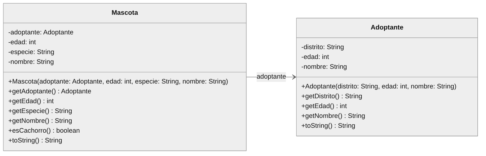

# Ejercicio 1 - Refugio de Mascotas

**Nivel:** básico &nbsp;|&nbsp; **Tiempo sugerido:** 25 minutos &nbsp;|&nbsp; **Puntaje:** 20 puntos

Un refugio de animales registra cada adopción: qué mascota se entrega y quién la adopta. Las capas **Vista** y **Controlador** ya están desarrolladas. Su tarea es implementar las dos clases de la capa **Modelo** siguiendo el diagrama UML.

**Qué practica:** atributos privados, constructor completo, métodos *getters*, `toString()` con formato exacto y una clase que tiene como atributo un objeto de otra clase.



## Indicaciones

- Trabaje únicamente en el paquete `Modelo`. La clase `Adoptante` ya existe vacía; la clase `Mascota` debe crearla usted.
- Respete el orden de los parámetros de los constructores que muestra el diagrama.
- No modifique los paquetes `Vista` y `Controlador` ni la carpeta `test`.

## Requerimientos

### 1. Clase `Adoptante` (8 puntos)

1.1. Declare los atributos privados `distrito`, `edad` y `nombre`, el constructor `Adoptante(distrito, edad, nombre)` y los métodos `getDistrito()`, `getEdad()` y `getNombre()` **(4 puntos)**.

1.2. Sobrescriba `toString()` con el formato `nombre (edad años) - distrito` **(4 puntos)**. Ejemplo con `new Adoptante("Miraflores", 28, "Lucía Quispe")`:

```text
Lucía Quispe (28 años) - Miraflores
```

### 2. Clase `Mascota` (12 puntos)

2.1. Declare los atributos privados `adoptante` (de tipo `Adoptante`), `edad`, `especie` y `nombre`, el constructor `Mascota(adoptante, edad, especie, nombre)` y los métodos `getAdoptante()`, `getEdad()`, `getEspecie()` y `getNombre()`. `getAdoptante()` debe retornar el mismo objeto recibido en el constructor **(4 puntos)**.

2.2. Sobrescriba `toString()` de modo que retorne **dos líneas** separadas por un salto de línea (`\n`), sin salto de línea al final. La segunda línea empieza con dos espacios seguidos de `-> Adoptante: ` y debe usar el `toString()` del adoptante **(5 puntos)**. Ejemplo con el adoptante anterior y `new Mascota(adoptante, 3, "Perro", "Rocky")`:

```text
Mascota: Rocky [Perro, 3 años]
  -> Adoptante: Lucía Quispe (28 años) - Miraflores
```

La palabra `años` se escribe siempre igual, aunque la edad sea 1.

2.3. Implemente el método `esCachorro()`, que retorna `true` si la mascota tiene **menos de 2 años** y `false` en caso contrario **(3 puntos)**.

## Ejemplo de ejecución

Cuando sus dos clases estén completas podrá ejecutar el proyecto (clase `Controlador.Principal`):

```text
--- REFUGIO DE MASCOTAS ---
1. Registrar adopción
2. Ver última adopción
3. Salir
Seleccione una opción: 1

--- DATOS DEL ADOPTANTE ---
Nombre del adoptante: Lucía Quispe
Edad del adoptante: 28
Distrito: Miraflores

--- DATOS DE LA MASCOTA ---
Nombre de la mascota: Rocky
Especie: Perro
Edad de la mascota (años): 1

--- ADOPCIÓN REGISTRADA ---
Mascota: Rocky [Perro, 1 años]
  -> Adoptante: Lucía Quispe (28 años) - Miraflores
Nota: es un cachorro, requiere vacunas de refuerzo.
```

## Calificación automática

| Prueba | Qué revisa | Puntos |
|---|---|---|
| Pregunta 1.1 | Constructor y *getters* de `Adoptante` | 4 |
| Pregunta 1.2 | `toString()` de `Adoptante` | 4 |
| Pregunta 2.1 | Constructor y *getters* de `Mascota` | 4 |
| Pregunta 2.2 | `toString()` de `Mascota` | 5 |
| Pregunta 2.3 | Método `esCachorro()` | 3 |
| **Total** | | **20** |
