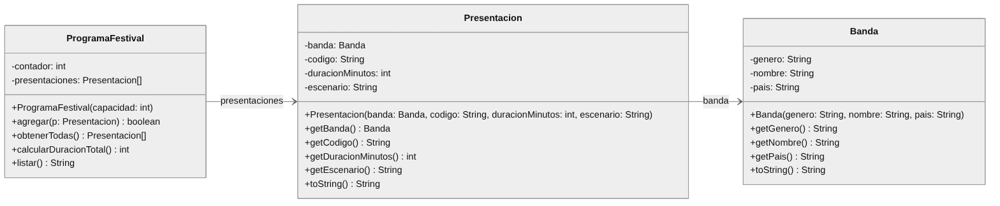

# Ejercicio 2 - Festival de Música

**Nivel:** intermedio &nbsp;|&nbsp; **Tiempo sugerido:** 45 minutos &nbsp;|&nbsp; **Puntaje:** 20 puntos

Los organizadores de un festival necesitan armar el programa del día: qué banda toca, en qué escenario y cuánto dura cada presentación. Las capas **Vista** y **Controlador** ya están desarrolladas. Su tarea es implementar las tres clases de la capa **Modelo** siguiendo el diagrama UML.

**Qué practica:** lo del Ejercicio 1, más un registro que guarda objetos en un **arreglo**: agregar con control de capacidad, devolver solo los elementos registrados, recorrer el arreglo para acumular y armar un texto con `StringBuilder`.



## Indicaciones

- Trabaje únicamente en el paquete `Modelo`. La clase `Banda` ya existe vacía; las clases `Presentacion` y `ProgramaFestival` debe crearlas usted.
- Respete el orden de los parámetros de los constructores que muestra el diagrama.
- No modifique los paquetes `Vista` y `Controlador` ni la carpeta `test`.

## Requerimientos

### 1. Clase `Banda` (3 puntos)

Atributos privados `genero`, `nombre` y `pais`; constructor `Banda(genero, nombre, pais)`; métodos `getGenero()`, `getNombre()` y `getPais()`; y `toString()` con el formato `nombre (genero, pais)`. Ejemplo con `new Banda("Cumbia amazónica", "Los Mirlos", "Perú")`:

```text
Los Mirlos (Cumbia amazónica, Perú)
```

### 2. Clase `Presentacion` (4 puntos)

Atributos privados `banda` (de tipo `Banda`), `codigo`, `duracionMinutos` y `escenario`; constructor `Presentacion(banda, codigo, duracionMinutos, escenario)`; métodos `getBanda()`, `getCodigo()`, `getDuracionMinutos()` y `getEscenario()`. `getBanda()` debe retornar el mismo objeto recibido en el constructor.

El `toString()` retorna **dos líneas** separadas por un salto de línea (`\n`), sin salto de línea al final. La segunda línea empieza con dos espacios seguidos de `-> Banda: ` y debe usar el `toString()` de la banda. Ejemplo con la banda anterior y `new Presentacion(banda, "PR-01", 60, "Principal")`:

```text
Presentación [PR-01] en escenario Principal (60 min)
  -> Banda: Los Mirlos (Cumbia amazónica, Perú)
```

### 3. Clase `ProgramaFestival`: constructor y `obtenerTodas()` (3 puntos)

Atributos privados `presentaciones` (arreglo de `Presentacion`) y `contador` (cantidad de presentaciones registradas). El constructor `ProgramaFestival(capacidad)` crea el arreglo con esa capacidad.

El método `obtenerTodas()` retorna **un arreglo nuevo que contiene únicamente las presentaciones registradas**: su tamaño es igual a la cantidad agregada (no a la capacidad) y no tiene posiciones `null`. Con el programa recién creado retorna un arreglo de tamaño 0, nunca `null`.

### 4. Método `agregar(Presentacion p)` (4 puntos)

Guarda la presentación en la siguiente posición libre del arreglo y retorna `true`. Si el arreglo está lleno no guarda nada y retorna `false`. Las presentaciones se guardan en el orden en que se agregan (2 puntos por agregar correctamente y 2 puntos por respetar la capacidad).

### 5. Método `calcularDuracionTotal()` (2 puntos)

Retorna la suma de las duraciones, en minutos, de todas las presentaciones registradas. Si no hay ninguna retorna 0.

### 6. Método `listar()` (4 puntos)

Retorna un `String` con el programa del festival, armado con **`StringBuilder`**:

- Una línea por cada presentación registrada, con el formato `número. codigo - nombre de la banda - duración min`. La numeración empieza en 1.
- Una última línea con el formato `Duración total: N min`.
- Las líneas se separan con un salto de línea (`\n`).

Ejemplo con dos presentaciones registradas:

```text
1. PR-01 - Los Mirlos - 60 min
2. PR-02 - Bareto - 45 min
Duración total: 105 min
```

Si no hay presentaciones registradas, el texto tiene solo la última línea:

```text
Duración total: 0 min
```

## Ejemplo de ejecución

Con las tres clases completas podrá ejecutar el proyecto (clase `Controlador.Principal`). El programa admite como máximo 5 presentaciones. La opción 3 del menú muestra:

```text
--- PROGRAMA DEL FESTIVAL ---
1. PR-01 - Los Mirlos - 60 min
2. PR-02 - Bareto - 45 min
Duración total: 105 min
```

## Calificación automática

| Prueba | Qué revisa | Puntos |
|---|---|---|
| Pregunta 1 | Clase `Banda` | 3 |
| Pregunta 2 | Clase `Presentacion` | 4 |
| Pregunta 3 | Constructor de `ProgramaFestival` y `obtenerTodas()` | 3 |
| Pregunta 4.1 | `agregar` cuando hay espacio | 2 |
| Pregunta 4.2 | `agregar` cuando el arreglo está lleno | 2 |
| Pregunta 5 | `calcularDuracionTotal()` | 2 |
| Pregunta 6 | `listar()` (se verifica además que use `StringBuilder`) | 4 |
| **Total** | | **20** |
