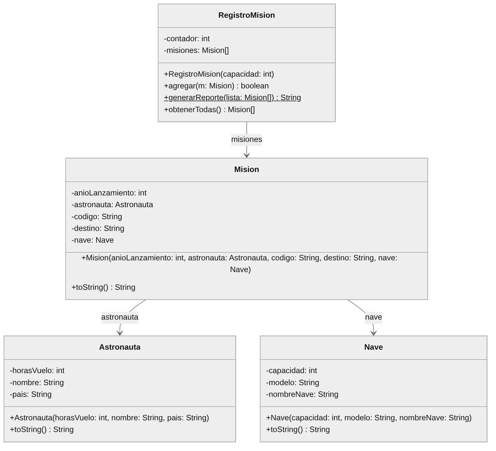

# Ejercicio 3 - Misiones Espaciales (simulacro de examen)

**Nivel:** simulacro de la Práctica Calificada 3 &nbsp;|&nbsp; **Duración:** 90 minutos &nbsp;|&nbsp; **Puntaje:** 20 puntos (18 automáticos + 2 de entrega)

Resuélvalo como si fuera el examen: con cronómetro, sin ayuda y haciendo un *commit* por cada clase.

Una agencia espacial necesita un "Control de Misiones" para registrar sus lanzamientos. Las capas **Vista** y **Controlador** ya están completamente desarrolladas e integradas. Su tarea consiste exclusivamente en implementar las clases de la capa **Modelo** siguiendo de manera estricta el siguiente diagrama UML:



## Indicaciones

- Trabaje únicamente en el paquete `Modelo`. La clase `Astronauta` ya existe vacía; las demás debe crearlas usted.
- Los nombres de clases, atributos y métodos, así como **el orden de los parámetros de los constructores**, deben ser exactamente los del diagrama UML.
- El diagrama no muestra los *getters*: debe crear uno por cada atributo de `Astronauta`, `Nave` y `Mision`, con el nombre estándar (`getHorasVuelo()`, `getNombreNave()`, `getAnioLanzamiento()`, etc.).
- No modifique los paquetes `Vista` y `Controlador` ni la carpeta `test`.
- El proyecto no compilará ni podrá ejecutarse hasta que existan las cuatro clases del modelo. Un error de compilación en cualquiera de ellas hace que todas las preguntas obtengan 0.

## Requerimientos de entrega (2 puntos, igual que en el examen)

1. Realice **un commit por cada clase completada**.
2. En el mensaje de cada commit debe aparecer su **nombre completo** y la descripción de la clase o tarea realizada.

Estos 2 puntos no los revisa el corrector automático; sirven para que practique la forma de entrega.

## Requerimientos

1. **Clases básicas (4 puntos: 2 por cada clase).** Implemente las clases `Astronauta` y `Nave` con sus atributos privados, constructores completos, *getters* y `toString()`.

   Formato de `toString()` de `Astronauta`: `nombre (pais, horasVuelo h de vuelo)`. Ejemplo con `new Astronauta(1200, "Killa Mamani", "Perú")`:

   ```text
   Killa Mamani (Perú, 1200 h de vuelo)
   ```

   Formato de `toString()` de `Nave`: `Nave: nombreNave (modelo modelo) - capacidad tripulantes`. Ejemplo con `new Nave(6, "X-200", "Aurora")`:

   ```text
   Nave: Aurora (modelo X-200) - 6 tripulantes
   ```

2. **Clase `Mision` (4 puntos).** Tiene como atributos un objeto `Astronauta` (el comandante) y un objeto `Nave`. Constructor `Mision(anioLanzamiento, astronauta, codigo, destino, nave)`. `getAstronauta()` y `getNave()` deben retornar los mismos objetos recibidos en el constructor.

   El `toString()` retorna **tres líneas** separadas por salto de línea (`\n`), sin salto de línea al final, y debe usar los `toString()` del astronauta y de la nave. Ejemplo con los objetos anteriores, código `MS-501`, destino `Marte` y año `2031`:

   ```text
   Misión [MS-501]: destino Marte (2031)
     -> Comandante: Killa Mamani (Perú, 1200 h de vuelo)
     -> Nave: Aurora (modelo X-200) - 6 tripulantes
   ```

   Observe que en la tercera línea el texto `Nave: ` ya viene del `toString()` de `Nave` (no lo escriba dos veces), mientras que en la segunda línea el texto `Comandante: ` sí debe agregarlo usted.

3. **Registro con arreglo (3 puntos).** Cree la clase `RegistroMision` con el atributo `misiones` (arreglo de `Mision`) y el atributo `contador`. El constructor recibe la capacidad del arreglo. El método `obtenerTodas()` retorna **un arreglo nuevo que contiene únicamente las misiones registradas**: su tamaño es igual a la cantidad agregada (no a la capacidad), sin posiciones `null`. Con el registro recién creado retorna un arreglo de tamaño 0, nunca `null`.

4. **Método `agregar(Mision m)` (2 puntos: 1 + 1).** Guarda la misión en la siguiente posición libre y retorna `true`; si el arreglo está lleno retorna `false`.

5. **Reporte tabular (5 puntos: 2 por el contenido y 3 por el formato exacto).** Implemente el método **estático** `generarReporte(Mision[] lista)`, que retorna un `String` con el reporte. Debe usar **`StringBuilder`** y **`String.format()`** (se verifica para los 3 puntos de formato).

   - Columnas alineadas a la izquierda, separadas por ` | ` (espacio, barra, espacio), con estos anchos: Código 10, Destino 15, Año 5, Comandante 20, Nave 15 caracteres.
   - En la columna Comandante va el nombre del astronauta y en la columna Nave el nombre de la nave.
   - Antes y después de las filas de datos va una línea de 77 guiones (`-`).
   - La última línea es `Total de misiones: N`, donde N es la cantidad de misiones del arreglo recibido.
   - Cada línea termina con un salto de línea (`\n`). No se evalúan los espacios sobrantes al final de cada línea.
   - El título `--- REPORTE DE MISIONES ---` **no** forma parte del texto que retorna el método: lo imprime la Vista.

**Salida esperada del reporte (opción 3 del menú):**

```text
--- REPORTE DE MISIONES ---
CÓDIGO     | DESTINO         | AÑO   | COMANDANTE           | NAVE           
-----------------------------------------------------------------------------
MS-501     | Marte           | 2031  | Killa Mamani         | Aurora         
MS-502     | Luna            | 2029  | Inti Rojas           | Cóndor I       
-----------------------------------------------------------------------------
Total de misiones: 2
```

## Calificación automática

| Prueba | Qué revisa | Puntos |
|---|---|---|
| Pregunta 1.1 | Clase `Astronauta` | 2 |
| Pregunta 1.2 | Clase `Nave` | 2 |
| Pregunta 2 | Clase `Mision` | 4 |
| Pregunta 3 | Constructor de `RegistroMision` y `obtenerTodas()` | 3 |
| Pregunta 4.1 | `agregar` cuando hay espacio | 1 |
| Pregunta 4.2 | `agregar` cuando el arreglo está lleno | 1 |
| Pregunta 5.1 | Contenido del reporte | 2 |
| Pregunta 5.2 | Formato exacto del reporte | 3 |
| **Total automático** | | **18** |
